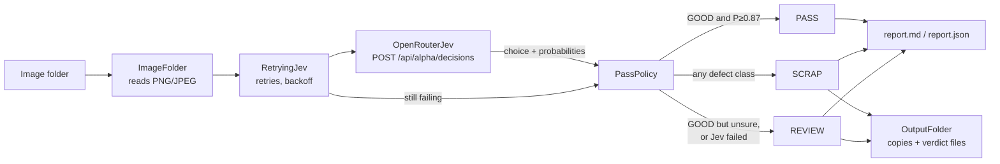

# spring-ai-damage-detector

A Spring Boot command-line tool that checks top-view photos of through-hole transistors for defects. Each image goes to
the Jev decision model through the OpenRouter Decisions API. The tool lets a part pass only when Jev answers GOOD with
P(GOOD) at or above the pass threshold (default 0.87). Every other image is flagged for scrap or review.

> **This is a showcase and teaching project**, not a production quality-control system. It shows how to put an AI
> classifier behind a safe decision rule, how to measure that rule honestly, and how a feature moves from idea to merged
> code with a structured, test-first workflow.

## What you can learn from this project

| Topic | Where to look |
|---|---|
| Wrapping an AI model behind a **safe decision rule** (zero false passes, uncertainty goes to a human) | [How it works](#how-it-works), `domain/PassPolicy.java` |
| **Measuring** an AI classifier instead of trusting it: false passes, auto-pass rate, threshold sweep | [Evaluate the pass rule](#evaluate-the-pass-rule-on-labelled-images) |
| Calling a **decision API** with an image as a data URL | `jev/OpenRouterJev.java`, `jev/DefectQuestion.java` |
| **Resilience**: retries with backoff, timeouts, and failure that is always safe | `jev/RetryingJev.java`, [ADR-004](docs/product/architecture/adr-004-jev-failure-resilience-retry-decorator.md) |
| **Ports and adapters** in a small modular monolith, with architecture rules enforced by tests | [Project tour](#project-tour) |
| **Acceptance-test-driven development** with Cucumber, WireMock and mutation testing | [How it is tested](#how-it-is-tested) |
| A **clean CLI contract**: one-line refusals, meaningful exit codes, atomic report writing | [Exit codes](#exit-codes), [ADR-005](docs/product/architecture/adr-005-cli-error-feedback-and-exit-codes.md) |
| **Secret hygiene**: the API key never enters the image, the logs or the error messages | [Run with Docker](#run-with-docker) |
| An **end-to-end, documented delivery** from discovery to merged PR | [How this project was built](#how-this-project-was-built) |

## How it works



1. **Ask.** Each image is sent to Jev (model `typesafe/jev-1.13`) as a base64 data URL, together with one choice question:
   *GOOD, MISPLACED, DAMAGED_CASE, CUT_LEAD or BENT_LEAD?* Each class has a written criterion
   ([`DefectQuestion.java`](src/main/java/de/aboutlabs/damagedetector/jev/DefectQuestion.java)). Jev returns the chosen
   class and a probability for each class. Only the image bytes are sent: never the file name or the label.
2. **Decide.** [`PassPolicy`](src/main/java/de/aboutlabs/damagedetector/domain/PassPolicy.java) turns the answer into a
   verdict:

   | Jev's answer | Verdict | Why |
   |---|---|---|
   | GOOD with P(GOOD) ≥ threshold | **PASS** | Confident and good: the only way to pass |
   | Any defect class | **SCRAP** | Jev saw a defect |
   | GOOD but P(GOOD) < threshold | **REVIEW** | Leaning good, not sure enough: a human decides |
   | No usable answer after retries | **REVIEW** | A failure must never let a part through |

3. **Record.** Images that do not pass are copied to `scrap/` or `review/` with a text file holding the verdict, and the
   run writes a Markdown and a JSON report.

**The key idea:** an AI model will sometimes be wrong, so the design asks *which* mistake is acceptable. A false pass (a
defect shipped as good) is the expensive one, so the rule is tuned to make it zero and pays with more images going to
REVIEW. The threshold is not guessed: `--evaluate` measures it on labelled images.

## Quick start

You need Java 21, an [OpenRouter](https://openrouter.ai) API key with credit, and the sample images (see
[Sample data](#sample-data)).

```sh
# 1. Build (runs all tests)
./mvnw clean verify

# 2. Put the key in .env (gitignored): one line, OPENROUTER_API_KEY=<your key>, no quotes, no export.
#    Load it into the shell without printing it:
set -a; . ./.env; set +a

# 3. Measure the pass rule on the labelled images (about 3 minutes, about $0.04)
java -jar target/damage-detector-0.1.0-SNAPSHOT.jar --evaluate --input=images --output=out/eval-1
echo "exit code: $?"

# 4. Read the result
less out/eval-1/evaluation.md
```

Do not pass the key as an argument. Use a fresh output folder for every run, and keep it outside the input folder.

## Inspect a folder (batch mode)

```sh
java -jar target/damage-detector-0.1.0-SNAPSHOT.jar --input=<image folder> --output=<output folder>
```

Writes `report.md` and `report.json`. Images that do not pass are copied to `scrap/` or `review/`, each with a text file
holding its verdict.

## Evaluate the pass rule on labelled images

```sh
java -jar target/damage-detector-0.1.0-SNAPSHOT.jar --evaluate --input=images --output=out/eval
```

The first sub-folder of each image is its label: `good`, `bent_lead`, `cut_lead`, `damaged_case` or `misplaced`.
Images without a label are skipped and counted, and they are not sent to Jev. The label is used only for scoring. It is
never sent to Jev. The run writes `evaluation.md` and `evaluation.json`: false passes, the good auto-pass rate, a
per-class table, a threshold sweep, the run date, the Jev cost and the elapsed seconds. A rerun into the same folder
replaces both files.

The sweep shows, for every threshold from 0.50 to 0.99, the false passes and the good parts that pass automatically.
It is recomputed from the same Jev answers, so it costs no extra Jev calls. `evaluation.md` shows 0.80 to 0.95 and the
configured threshold, and names the lowest threshold with 0 false passes. `evaluation.json` holds every threshold. The
tool never changes the threshold: you decide.

**Reading the two key numbers:**

- **False passes**: defects that would have passed. The target is 0. Any value above 0 gives exit code 2.
- **Good auto-pass rate**: good parts that passed without a human. This is the benefit. A higher threshold lowers it;
  a lower threshold raises it, but risks false passes.

## Configuration

Every setting can be overridden on the command line as `--<property>=<value>`.

| Property | Default | Meaning |
|---|---|---|
| `detector.pass-threshold` | `0.87` | Minimum P(GOOD) for a PASS, from 0 to 1 |
| `detector.jev.model` | `typesafe/jev-1.13` | The Jev model on OpenRouter |
| `detector.jev.base-url` | `https://openrouter.ai` | API address (http or https) |
| `detector.jev.connect-timeout` / `read-timeout` | `10s` / `30s` | Limits for one call |
| `detector.jev.retry.max-attempts` | `3` | Attempts per image before REVIEW |
| `detector.jev.retry.initial-backoff` / `max-backoff` | `1s` / `10s` | Wait between attempts (a `Retry-After` header is honoured) |
| `OPENROUTER_API_KEY` (environment) | — | Required. Never pass it as an argument |

Example: `--detector.pass-threshold=0.90`.

A run that cannot work is refused before any image is judged, with one line that names the cause and exit 1: a pass
threshold that is not a number from 0 to 1, a folder without PNG/JPEG images, a missing or blank API key, or a Jev
address that is not an http or https address. Any unexpected failure gives one line `Inspection failed: <cause>. See log
for details.` and exit 1; the details are in `damage-detector.log` in the output folder.

## Run with Docker

Docker is the only requirement on the demo host: no JDK, no Maven. The image holds no API key. The key comes from your
`.env` (plain `OPENROUTER_API_KEY=value`, no `export`, no quotes) at run time.

```sh
# Build
SHA=$(git rev-parse --short=12 HEAD)
[ -z "$(git status --porcelain)" ] || SHA="$SHA-dirty"
docker build --build-arg GIT_SHA="$SHA" -t damage-detector:0.1.0 -t "damage-detector:0.1.0-$SHA" .

# Host-side guard: the container cannot see that ./out lies inside ./images
outside() { case "$(realpath -m "$2")/" in "$(realpath "$1")"/*)
  echo "Refused: $2 is the same as or inside $1" >&2; return 1;; esac; }

# Batch inspection
outside images out && mkdir -p out &&
docker run --rm --user "$(id -u):$(id -g)" --env-file .env \
  -v "$PWD/images:/in:ro" -v "$PWD/out:/out" \
  damage-detector:0.1.0 --input=/in --output=/out
echo "exit code: $?"

# Evaluation
outside images out && mkdir -p out &&
docker run --rm --user "$(id -u):$(id -g)" --env-file .env \
  -v "$PWD/images:/in:ro" -v "$PWD/out:/out" \
  damage-detector:0.1.0 --evaluate --input=/in --output=/out/eval
echo "exit code: $?"   # 2 = false pass at the configured threshold
```

`mkdir -p out` matters: if Docker creates `out` itself it is owned by root and the run is refused. `--user` lets you
delete the results without sudo. Use a fresh output folder per run. The exit codes are the table below, passed on
unchanged; 125 to 127 mean Docker itself failed. Keep the project on the WSL filesystem, not below `/mnt/c`.

`scripts/container-check.sh --self-test` proves that the image scan catches a key on deliberately bad images.
`scripts/container-check.sh image-scan` builds the image from a scratch copy with a planted key and scans it. It needs
Docker and stays out of `./mvnw verify`. It never writes your `.env`.

## Exit codes

| Code | Meaning |
|---|---|
| 0 | The run completed. In evaluate mode this also means no defect passed. |
| 1 | Refused or unexpected error, for example a missing key, an unusable folder or a folder without labels. One line on stderr. |
| 2 | Evaluate mode: at least one defect passed at the configured pass threshold (a false pass). The reports are written. |
| 3 | No image could be judged. The reports are written and the line `0 of <n> images judged by Jev - check OPENROUTER_API_KEY and network` is printed. Exit 3 wins over exit 2. |
| 130 | Interrupted with Ctrl-C. No finished report: there is no `report.md` or `evaluation.md`. |
| 143 | Interrupted by a stop request (SIGTERM, for example `docker stop`). No finished report. |
| 137 | Killed (SIGKILL, for example out of memory or `docker kill`). The JVM cannot catch it, so there is no line and no finished report. |

Every report is written whole under its final name, `report.md` (or `evaluation.md`) last. A folder without that summary
is incomplete. After an interrupted run, rerun into a fresh output folder.

## Results on the sample data

Three full runs over all 253 images (213 good, 10 of each of the four defect classes), at threshold 0.87:

| Measure | Result |
|---|---|
| False passes | **0** in every run |
| Good parts passed automatically | 34 % to 38 % (about 46 % at 0.86) |
| Cost per run | about $0.037 |
| Time per run | about 165 s |

**Lessons worth noticing:**

- **The model is not deterministic.** The same image can get a different P(GOOD) on the next run; across runs, 73 to 99
  of the 213 good parts passed. That is why the default is 0.87, one step above 0.86, the lowest threshold that gave 0
  false passes. Re-measure before relying on a threshold.
- **Safety has a price.** Zero false passes means most good parts still go to REVIEW. Whether that is worth it is a
  business decision, and the threshold sweep makes the trade-off visible.
- **40 defect images are a small sample.** "0 false passes" on 40 defects is evidence, not proof.

## Project tour

Java 21, Spring Boot 4.1, Maven. A modular monolith in ports-and-adapters style, under
`src/main/java/de/aboutlabs/damagedetector/`:

| Package | Role | Key classes |
|---|---|---|
| `domain` | Pure business rules, no Spring, no I/O | `PassPolicy`, `Verdict`, `JevOutcome` (sealed), `ThresholdSweep`, `Evaluation` |
| `jev` | Adapter to the Jev API, plus retry decorator | `OpenRouterJev`, `RetryingJev`, `DefectQuestion` |
| `inspection` | Reading images and writing results | `ImageFolder` (only reader), `OutputFolder` (only writer, atomic), `Inspector` |
| `batch` | Batch mode use case | `BatchInspection`, `ReportWriter` |
| `evaluate` | Evaluate mode use case | `LabelledEvaluation`, `EvaluationWriter` |
| `cli` | Arguments, exit codes, one-line feedback | `CliArguments`, `DetectorCommand`, `ErrorFeedback` |
| `probe` | Checks that refuse a doomed run before any image is sent | `Probe`, `ProbeResult` |
| root | Startup and wiring | `DetectorLauncher`, `DetectorConfiguration`, `DetectorProperties` |

The design decisions and their trade-offs are in the
[architecture brief](docs/product/architecture/brief.md) and six ADRs in `docs/product/architecture/`.

## How it is tested

- **Acceptance tests (Cucumber)** in `src/test/resources/features/transistor-damage-detection/acceptance/`: a walking
  skeleton and five milestones (evaluate, threshold sweep, Jev failure resilience, Docker run, refusal feedback). They
  drive the real CLI, in-process or as a real jar subprocess.
- **Fakes only at the edge.** Jev is replaced by WireMock (a real HTTP server, so timeouts and dropped connections are
  real) or by `MockRestServiceServer` for adapter tests. The retry wait and the clock are faked so tests stay fast and
  repeatable. Files are real, in temporary folders. See the
  [test infrastructure policy](docs/architecture/atdd-infrastructure-policy.md).
- **Unit tests** for the domain rules, the Jev adapter and the CLI logic.
- **Architecture tests (ArchUnit)** turn design rules into failing tests: the domain depends only on the JDK basics (no
  Spring, no I/O), only `ImageFolder` reads files, only `OutputFolder` writes them, only the CLI touches stdout/stderr,
  and every Jev call goes through the retry decorator.
- **Mutation testing (PIT)** checks that the tests actually catch bugs: 95 % of injected faults are caught (gate: 80 %).
- **CI** (`.github/workflows/ci.yml`) runs the build and tests, a secret scan (gitleaks), mutation testing on pull
  requests and the Docker image check. Pre-commit hooks (`.pre-commit-config.yaml`) run gitleaks on commit and
  `./mvnw verify` on push.

```sh
./mvnw verify                                   # all tests, no Docker needed
./mvnw test-compile org.pitest:pitest-maven:mutationCoverage   # mutation report in target/pit-reports
scripts/container-check.sh                      # Docker scenarios
```

## How this project was built

The feature was delivered with nWave, a wave-based workflow in which each stage
leaves a written record. Following the documents in order is a good way to see how a vague idea becomes tested code:

| Wave | Question it answers | Record |
|---|---|---|
| Brief | What do we want? | [`docs/brief.md`](docs/brief.md) |
| DISCOVER | Is the problem real, and for whom? | `docs/feature/transistor-damage-detection/discover/`, `docs/product/personas/` |
| DISCUSS | What exactly must it do? User stories and acceptance criteria | `docs/feature/transistor-damage-detection/feature-delta.md` |
| SPIKE | Can Jev actually tell good from defective? A time-boxed experiment | `docs/feature/transistor-damage-detection/spike/` |
| DESIGN | How is it structured, and why? | `docs/product/architecture/` |
| DEVOPS | How is it built, checked and shipped? | `.github/workflows/ci.yml`, `Dockerfile` |
| DISTILL | Which executable tests define "done"? | The `.feature` files |
| DELIVER | Implement step by step, test first | `docs/feature/transistor-damage-detection/deliver/`, git history |

The [evolution document](docs/evolution/transistor-damage-detection-evolution.md) summarises the whole delivery and ends
with an honest retrospective: what went wrong and what to do differently next time.

## Limitations

- A showcase: one camera angle, one part type, one dataset. Not validated with real quality inspectors.
- Jev's answers vary between runs, so the threshold must be re-measured over time.
- Cost and latency are measured by hand, not monitored.
- The sample data may be used for non-commercial purposes only.

## Sample data

The images come from the MVTec AD dataset, category "transistor", and are not part of this repository. Download the
dataset from [MVTec](https://www.mvtec.com/company/research/datasets/mvtec-ad) and arrange the images under `images/`
with one sub-folder per label: `good`, `bent_lead`, `cut_lead`, `damaged_case`, `misplaced`. `images/` and `out/` are
gitignored.

MVTec AD is © MVTec Software GmbH and is licensed under
[CC BY-NC-SA 4.0](https://creativecommons.org/licenses/by-nc-sa/4.0/), for non-commercial use only.
Paul Bergmann, Kilian Batzner, Michael Fauser, David Sattlegger, Carsten Steger: "The MVTec Anomaly Detection Dataset:
A Comprehensive Real-World Dataset for Unsupervised Anomaly Detection", IJCV 2021.
