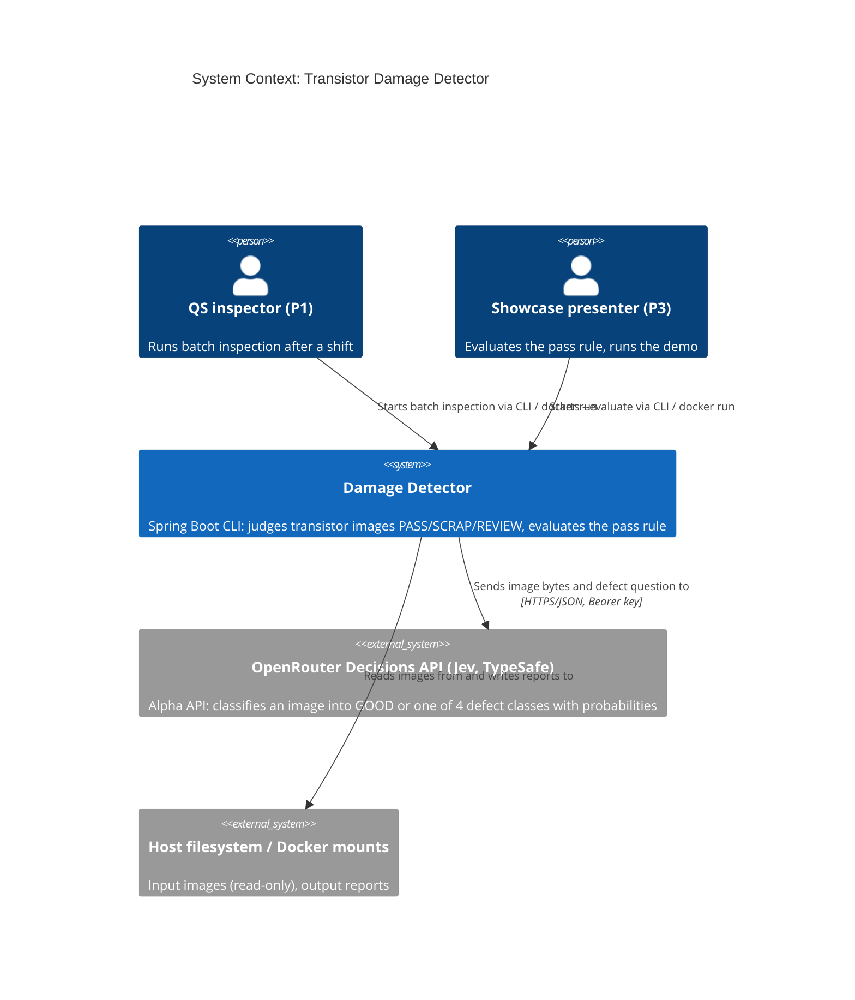
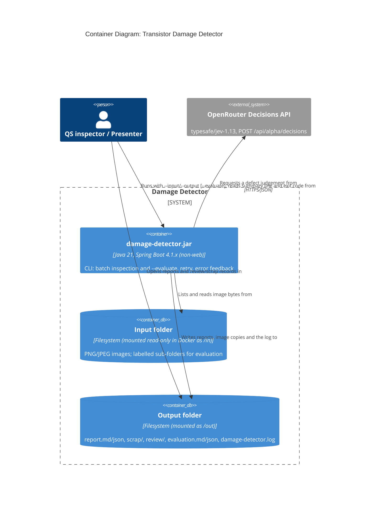
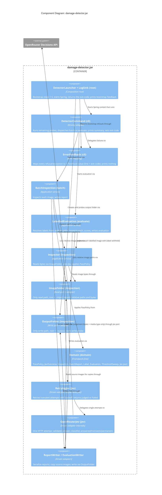

# Architecture Brief: spring-ai-damage-detector

SSOT for architecture. It was bootstrapped on 2026-10-30 in the DESIGN wave of feature `transistor-damage-detection`. No `## System Architecture` (Titan) or `## Domain Model` (Hera) section existed before, so this brief starts with the application architecture.

## Application Architecture

**Status**

- **Design:** Option A, confirmed by the user on 2026-10-30.
- **Upstream changes:** UC-1 to UC-4 confirmed on 2026-10-30.
- **Framework:** upgrade to Spring Boot 4.1 decided on 2026-10-30 (ADR-006).
- **ADR-002** (Jev via OpenRouter) was already accepted at the SPIKE promotion.
- **Peer review:** iterations 1 and 2 were rejected. The iteration-2 findings are fixed in one targeted pass, which the orchestrator verifies. There is no third review.
- **Final wave gate:** conditionally approved after revision cycle 1 (2026-11-06, with the user decisions Q1, Q3, Q5, Q7 and Q12). The last conditions (C2-1 to C2-5, DEVOPS N1) are applied in the docs.

**Scope**

- Paradigm: OOP (see `CLAUDE.md`).
- One Spring Boot CLI jar: no DB, no web endpoint, no Qwen (DISCUSS D12 and the out-of-scope list).

### System context and capabilities

The detector is a non-web Spring Boot 4.1 command-line application. It has two use cases on the same jar:

1. **Batch inspection**: `--input --output`. Every PNG/JPEG image below the input folder is judged by Jev. Each image becomes PASS, SCRAP or REVIEW. The tool writes `report.md` and `report.json`, and for every non-passed image a copy plus a `.txt` description under `scrap/` or `review/`.
2. **Evaluation**: `--evaluate --input --output`. The same judging runs on a labelled folder. The first sub-folder name is the ground-truth label, and it is used only for scoring. The tool writes `evaluation.md` and `evaluation.json`: false passes, good auto-pass, per-class recall, and a threshold sweep from one Jev pass.

Quality-attribute drivers, in priority order:

| # | Attribute | Driver | Architectural answer |
|---|---|---|---|
| 1 | Functional correctness / safety | C10: zero false passes, an errored image is never PASS (INV-1) | A sealed `JevOutcome` (judged or failed). `PassPolicy` maps a failure to REVIEW, so "a failed image passes" cannot be represented in the types. An answer is valid only if its choice and P(GOOD) are valid (ADR-003, ADR-004) |
| 2 | Confidentiality of ground truth | C11 / INV-2: labels and paths never reach Jev | The `Jev` port accepts only bytes and a media type. Labels are resolved only in `evaluate/`. ArchUnit forbids `inspection..` and `jev..` from depending on `evaluate..` or `domain.Label` |
| 3 | Reliability | US-03: the batch finishes despite Jev failures | Retry decorator on the Jev port. After the last attempt the image becomes REVIEW and the run continues (ADR-004) |
| 4 | Usability / operability | D23 / INV-5: one actionable stderr line, non-zero exit, no stack trace | One central error-feedback mapper, start-up probes before any paid call, and a fixed exit-code table (ADR-005) |
| 5 | Security | INV-3: the key is never in the image, logs or reports | The key comes only from the env/property. Error reasons are built from the HTTP status and the exception type, never from request data. `toString` stays redacted |
| 6 | Cost / time | K5: ≤ $0.05 and ≤ 10 min per 253 images | Sequential calls, one Jev call per image. The sweep is recomputed from stored outcomes (D17). Non-transient 4xx errors are not retried. The 30 s read timeout keeps K5 for runs with up to 3 hanging images |
| 7 | Maintainability / extensibility | C3: a DB or microservices later; supported framework | Ports and adapters with a framework-free `domain/`. Spring Boot 4.1 has OSS support until 2027-07-31 (ADR-006) |
| 8 | Portability | C2 / US-04: Docker | Only the contract is defined here (env key, `/in` and `/out` mounts). The image build belongs to DEVOPS |

Team and Conway check: a single developer/presenter (showcase, E6). One deployable fits the team, and there are no team boundaries to mirror.

### C4 Level 1: System Context

### C4 Level 2: Container

### C4 Level 3: Component (inside the jar)

This diagram is included because the jar holds 10 or more components across two use cases, and the C11 boundary needs to be visible.

### Component architecture and boundaries

Style: **modular monolith with ports and adapters** in one Maven module. All dependencies point toward `domain/`.

| Package | Components | Contract shape (effect isolation) |
|---|---|---|
| `domain/` | `PassPolicy`, `Verdict`, `JevJudgement`, `JevOutcome` (sealed: judged / failed), `Inspection`, `BatchReport`, `Label`, `Evaluation`, `ThresholdSweep`; the `Jev` port | **Pure functions.** Allow-list: `java.lang..`, `java.util..`, `java.time..` only |
| `inspection/` | `Inspector`, `ImageFolder`, `OutputFolder` | **`Inspector`**: pure read through `ImageFolder`; external effect = `Jev` calls; zero filesystem delta. **`ImageFolder`** is the **single read port**: root-scoped to `--input` and read-only. It returns relative image paths (sorted, as strings) and the bytes of one relative path, and it owns the real-path check (`checkRun`, plan-returning). It knows nothing about labels. **`OutputFolder`** is the **single write port**: root-scoped to `--output`. Its writes are `writeString` and `writeBytes`, both atomic (temp file + rename), both with the same root-escape rule. `ImageFolder` and `OutputFolder` are per-run objects built from the arguments, not beans |
| `probe/` | `Probe` contract (`probe()` → `ProbeResult`), `ProbeResult` (ok or refused(reason, details), pure value) | Interface and value only. `Probe` is implemented by `ImageFolder`, `OutputFolder`, `RetryingJev` and `PassThreshold` |
| `batch/` | `BatchInspection`, `ReportWriter` | **`BatchInspection`**: orchestration, no direct IO. **`ReportWriter`**: bounded change via `OutputFolder` (`report.md`, `report.json`, `scrap/**`, `review/**`). It reads the source images for copies via `ImageFolder`, never via a raw `Path` |
| `evaluate/` | `LabelledEvaluation`, `EvaluationWriter` | **`LabelledEvaluation`**: orchestration, no direct IO. It is the **only place where a `Label` is resolved**, as a pure function from relative path to optional label. **`EvaluationWriter`**: bounded change via `OutputFolder` (`evaluation.md`, `evaluation.json` only) |
| `jev/` | `OpenRouterJev` (implements `AttemptSource`), `AttemptSource` (package-private: one attempt plus the configuration probe), `AttemptResult` (package-private sealed: answered / transient / permanent), `RetryingJev` (the only `Jev` implementation), `DefectQuestion`, `Sleeper` | **External effect only**: one paid HTTP call per attempt, zero filesystem delta. `Sleeper` is an injected capability |
| `cli/` | `DetectorCommand` (was `BatchCommand`), `ErrorFeedback`, `CliArguments`, `PassThreshold` | **`DetectorCommand`**: bounded change, universe = stdout, stderr, exit code. **`ErrorFeedback`**: **pure** mapping (refusal or exception → `Feedback(line, exitCode)`); it prints nothing. **`CliArguments`**: unbounded preservation, `check(args)` returns a `ProbeResult` and writes nothing. **`PassThreshold`**: pure value; parses the raw setting, and its `probe()` refuses an unusable value |
| root | `DamageDetectorApplication` (main), `DetectorLauncher`, `LogSink`, `DetectorConfiguration`, `DetectorProperties` | The composition root. `main` is only `System.exit(DetectorLauncher.launch(args))`. **`DetectorLauncher`**: bounded change, universe = the created output directories, the probe file, the log path, stderr, the exit code. **`LogSink`**: **pure function**, returns the property map that names the log file; the logging system performs the only write |

**Allowed dependency edges.** These are enforced as ArchUnit rule 8; any edge not listed is forbidden.

| From | May depend on |
|---|---|
| root | everything |
| `cli` | `batch`, `evaluate`, `inspection`, `probe`, `domain` (`DetectorCommand` builds the per-run `ImageFolder`, `OutputFolder` and `PassPolicy` and hands them to the use case). **Never `jev`:** the root composition injects the Jev-side check into `DetectorCommand` as a plain `probe.Probe`, which is `RetryingJev` behind that interface |
| `batch` | `inspection`, `domain` |
| `evaluate` | `inspection`, `domain` (including `Label`) |
| `inspection` | `domain` (without `Label`), `probe` |
| `jev` | `domain` (without `Label`), `probe` |
| `probe` | nothing |
| `domain` | nothing |

`batch` and `evaluate` never depend on each other.

### Bootstrap sequence and logging (ADR-005)

`DamageDetectorApplication.main` is only `System.exit(DetectorLauncher.launch(args))`. `DetectorLauncher.launch` is the outermost composition root. It runs the whole program, never ends the JVM, and returns the exit code. It owns steps 1–5, which run before Spring starts. It prints each `Feedback` that `ErrorFeedback` returns (one stderr line, exit 1, 0 Jev calls).

**The refusal path is plan-returning.** Steps 1 and 2 only inspect and return a `ProbeResult`, so a refusal there has no effect to undo. Only the launcher acts on the result.

1. **Pre-parse the arguments:** `CliArguments.check(args)` returns a `ProbeResult`. Required `--input` and `--output`, no unknown option, and `--evaluate` without a value. Writes nothing.
2. **Real-path check:** `ImageFolder.rootedAt(input).checkRun(output)` returns a `ProbeResult`. Reads metadata only, writes nothing.
   - The input must exist as a folder (`toRealPath`), otherwise `INPUT_MISSING`.
   - The output's absolute path is **not** normalized first. Its **nearest existing ancestor** is found, `toRealPath` is taken on it, the remaining segments are appended, and the result is **normalized** before any comparison. This handles `..` in the part that does not exist yet.
   - The run is refused if the output **equals** the input (`isSameFile` when it exists) or lies **inside** it (component-wise `startsWith` on the normalized real paths). This also covers symlinks and `..`.
3. **Create the output folder:** the first half of `OutputFolder.probe()`. This is a declared delta: the missing directories from the nearest existing ancestor down to `--output`. On failure: `Cannot write to output folder <o>: <cause>`, and there is no log file.
4. **Write probe:** the second half of `OutputFolder.probe()`. It exercises the same mechanism as a real write: write `<output>/.damage-detector-write-probe.tmp`, atomically rename it to `.damage-detector-write-probe`, then delete it. On a normal exit it is always removed. If the JVM is killed in between, an empty leftover file is possible. That leftover is documented and harmless: it is not an image, and the next probe overwrites it.
5. **`LogSink.defaultPropertiesFor(realOutput)`** returns the property map that names `<real output>/damage-detector.log`. The launcher sets it as SpringApplication default properties (not ambient config). The logging system performs the only write. Console logging is off unless `--debug` is given. There is **no temp-dir fallback**: if steps 1–4 refuse, there is no log file, and the stderr line is the whole feedback.
6. **Start Spring.** `DetectorCommand` then runs the remaining probes in this order: `PassThreshold`, the input (≥ 1 image; in evaluate mode ≥ 1 labelled image instead), the injected Jev-side `probe.Probe` (API key, then base URL; `DetectorCommand` does not know it is `RetryingJev`). After that the use case runs.

**Catch points and phases (ADR-005):**

| Phase | An unexpected exception gives |
|---|---|
| Before step 5 (no log exists) | `Inspection failed: <short cause>.` from `ErrorFeedback.feedbackBeforeLog` |
| From step 5 on (log exists) | `Inspection failed: <short cause>. See log for details.` from `ErrorFeedback.feedbackFor` |

**The walking skeleton is not a bootstrap test.** Its steps call `SpringApplication.run` directly, so steps 1–5 do not run there. `DetectorCommand` therefore must not depend on the bootstrap having run: it builds its per-run objects from `CliArguments` itself. The bootstrap is tested through `DetectorLauncher.launch` and the real jar.

**`launch`'s initializers are public on purpose, as a test seam.** Its signature is `launch(String[] args, ApplicationContextInitializer<ConfigurableApplicationContext>... capabilities)`.
- It must be public because the in-process driver lives in another package (`acceptance.support`).
- The varargs let tests replace exactly the two non-deterministic capabilities (`Sleeper`, `Clock`), while still exercising steps 1–5 and the real wiring.
- The alternatives are worse: a test-only property would be a behaviour switch reachable from the CLI, and a second entry point would leave the tested path different from the production path.
- `main` passes none, and nothing on the command line can reach it.

### Declared write universe of `--output`

DISTILL asserts this set after a full run and after each refusal run. Pre-existing files are left alone unless the run replaces them under the same name, and nothing is ever written below `--input`.

| Run | Files created or overwritten |
|---|---|
| Batch, completed (exit 0/3) | `report.md`, `report.json`, `scrap/**`, `review/**`, `damage-detector.log` |
| Evaluate, completed (exit 0/2/3) | `evaluation.md`, `evaluation.json`, `damage-detector.log` |
| Refused at bootstrap steps 1–2 | nothing (the output folder is not even created) |
| Refused at steps 3–4 | possibly the created directories only |
| Refused at step 6 or unexpected exception | the created directories plus `damage-detector.log`. An exception while writing reports may also leave the files already published |
| Interrupted (exit 130/143/137) | the created directories and `damage-detector.log`. If the interrupt falls into the final write phase, also whole files already published, and possibly one `*.tmp` file. Never a partial file under a final name |
| Transient, any run | `.damage-detector-write-probe` and `.damage-detector-write-probe.tmp` (deleted at step 4); `<name>.tmp` beside each file while it is written (renamed or deleted) |

**On-write directory creation is in the universe.** `OutputFolder` creates missing parent directories on every write, for example `scrap/good/`. On the bootstrap path the root already exists. On the skeleton path, which skips the bootstrap, this is what creates the root. Directories are created only below the root, or the root's own missing ancestors, and never by anyone else.

### Writing reports (Q5, INV-6)

- **Reports are written only at the end of a run.** While images are inspected, the output folder receives nothing but the log.
- **Every `OutputFolder` write is atomic:** it writes `<name>.tmp` in the same folder, then renames it to `<name>` with `ATOMIC_MOVE`. On a failed write it deletes its temp file. The temp file shares the target's folder, so the rename never crosses a filesystem. The write probe exercises this rename, so a filesystem without it refuses the run at step 4 and not after a paid run.
- **Publish order:** copies and `.txt` descriptions first, then `report.json`, and `report.md` last. Evaluate: `evaluation.json`, then `evaluation.md`. The presence of the `.md` file means the run finished writing.
- **An interrupted run:** the code adds no signal handler. The JVM's own exit codes apply: 130 (SIGINT), 143 (SIGTERM), 137 (SIGKILL, for example `docker kill`). An interrupt during the final write phase may leave a whole `report.json` without `report.md`, because `report.json` is renamed first and `report.md` last (the same holds for `evaluation.json` and `evaluation.md`). **A folder without the summary (`report.md` / `evaluation.md`) is incomplete**, whatever else it holds. The user reruns into a fresh output folder. A report left by an earlier completed run in the same folder stays whole, so a rerun must not reuse the folder (the documented instruction is a fresh folder).

**DISTILL assertions:**
- The input tree hash is unchanged after every run, including refusals.
- The output tree equals the declared set for that run type.

### Driving ports

| Port | Contract |
|---|---|
| Batch CLI | `--input=<folder> --output=<folder>` → summary line on stdout (with `N Jev errors in REVIEW`), exit code (table below), report files |
| Evaluate CLI | `--evaluate --input=<labelled folder> --output=<folder>` → evaluation summary line, `evaluation.md/json`, exit code. `--evaluate` takes no value |
| Configuration | `detector.pass-threshold` (default 0.87, raised from 0.86 by the user after the slice-02 sweep on 2026-11-09; bound as raw text, so an unusable value is a refusal and not a binding failure) `detector.jev.retry.max-attempts` (3), `.initial-backoff` (1s), `.max-backoff` (10s) `detector.jev.connect-timeout` (10s), `detector.jev.read-timeout` (30s) `detector.jev.base-url`, `detector.jev.model` `DetectorConfiguration` maps these to plain constructor values |
| Output formats | Ratified field by field in feature-delta DDD-14 (evaluation) and DDD-15 (batch). Summary lines and refusal lines show paths **as the user typed them** |
| Secret | env `OPENROUTER_API_KEY` → `detector.jev.api-key` |
| Unknown options | Refused at bootstrap step 1. A dotted property and the Spring flags `debug` and `trace` are allowed |

### Driven ports and adapters

| Port | Adapter | Contract shape | Probe |
|---|---|---|---|
| `Jev` (domain): bytes + media type → `JevOutcome` | `RetryingJev` (takes the package-private `AttemptSource`) → `OpenRouterJev` → `POST /api/alpha/decisions` | External effect only. The port never throws for call failures. `OpenRouterJev`'s constructor takes a `RestClient.Builder` and plain values (base URL, model, key, connect timeout, read timeout) and has no `DetectorProperties` import. Construction never parses the base URL or validates the key: the client is built at the first attempt, after the probe | API key non-blank, then base URL is an absolute http/https address (no paid call) |
| **Input read port** (single) | `ImageFolder`, root = `--input` | Pure read: relative image paths and bytes per relative path. Used by `Inspector`, the use cases (listing) and `ReportWriter` (copy source) | Input exists (`checkRun`, step 2); ≥ 1 image (`probe()`, step 6). In evaluate mode `LabelledEvaluation` checks for ≥ 1 labelled image instead |
| **Output write port** (single) | `OutputFolder`, root = `--output` | Bounded change, the only writer. `writeString` and `writeBytes`, atomic, same root-escape rule. Used by `ReportWriter`, `EvaluationWriter` and the bootstrap | Create the folder, then write, rename and delete the probe file |
| Log file | Spring Boot logging, pointed at the file by `LogSink`'s property map | Logging is the single writer of `<output>/damage-detector.log`. `LogSink` itself is pure | Covered by the output probe (same folder) |
| Time | `Clock` (run date, elapsed time), `Sleeper` (backoff) | Capability injection, as replaceable beans | n/a |

### Exit-code contract (ADR-005)

| Code | Meaning |
|---|---|
| 0 | Run completed. In evaluate mode: 0 false passes at the configured threshold |
| 1 | Run refused or failed: a reason from the closed refusal set (ADR-005), or an unexpected exception. One stderr line, no stack trace |
| 2 | Evaluate: ≥ 1 false pass at the configured threshold (D18). Reports are written, and one stderr line is printed (Q7): `<n> false passes at pass threshold <t>: see <output>/evaluation.md` |
| 3 | No image judged by Jev (D14). Reports are written, and the stderr line is `0 of <n> images judged by Jev - check OPENROUTER_API_KEY and network` |
| 130, 143, 137 | Interrupted (SIGINT, SIGTERM, SIGKILL): no result. The JVM sets these codes; the run prints no line of its own. Rerun into a fresh output folder (INV-6) |

If several of 1, 2 and 3 apply, the order is 1 > 3 > 2.

### Earned Trust: probes (wire, then probe, then use)

| Dependency | Probe (step) | Substrate lie it catches |
|---|---|---|
| Arguments | Required options present; no unknown option (1) | A typo silently turning evaluate into batch |
| Input/output relation | Real-path equality or containment (2) | Symlinked or `..` paths that place the output inside the input, so the next run re-judges and re-pays for its own copies |
| Output folder | Create, then write, rename and delete the probe file (3–4) | A root-owned or read-only Docker bind mount; WSL2 DrvFs permission quirks; a filesystem without atomic rename |
| Input folder | Exists, has ≥ 1 image or labelled image (2, 6) | A wrong mount path (a `-v` typo creates an empty dir in Docker) |
| Pass threshold | A number within 0 to 1 (6) | A typo or a stray value in the setting |
| Jev configuration | API key non-blank; base URL an absolute http/https address (6) | A missing `--env-file`; a malformed address |
| Jev answer | Validity check on every attempt (ADR-004) | The alpha API returns an unknown class, a null probability or an out-of-range probability |

There is deliberately **no paid or network probe of Jev**: D14/US-03 require a written report on a 401.

**Probe enforcement layers:**
- **Subtype:** `probe.Probe`.
- **Structural:** ArchUnit rule 4.
- **Behavioural:** acceptance tests for a read-only output, output inside input, a missing key, an empty input, WireMock 503/timeout/malformed body/invalid answers.

### Technology stack

| Tech | Version | License | Rationale |
|---|---|---|---|
| Java | 21 (LTS) | GPLv2+CE (OpenJDK) | Existing; supported by Boot 4.1 |
| Spring Boot (starter, Jackson, RestClient starter) | **4.1.x**, latest patch, verified on Maven Central in DELIVER step 1 | Apache 2.0 | ADR-006: 3.5 OSS support ended 2026-06-30; 4.1 OSS runs until 2027-07-31. Brings Spring Framework 7 |
| Jackson | **3.x** (`tools.jackson`), Boot-managed | Apache 2.0 | Boot 4 default. `ReportWriter` and `WalkingSkeletonSteps` migrate from `com.fasterxml.jackson.databind.ObjectMapper` to `tools.jackson` `JsonMapper` in DELIVER step 1 (annotations stay `com.fasterxml.jackson.annotation`). No Jackson 2 on any classpath |
| Parameterized tests | JUnit `@ParameterizedTest`, Boot-managed | EPL 2.0 | Layer-1 example tables. jqwik is removed (user decision Q1, 2026-11-06) |
| Cucumber (JUnit Platform engine) | 7.x, a version compatible with Boot 4.1's JUnit; **verify in DELIVER step 1** (7.20.1 today) | MIT | Existing acceptance harness (WS strategy B) |
| WireMock standalone | 3.13.x or newer; **verify in DELIVER step 1** (3.13.2 today) | Apache 2.0 | Existing Jev stub. Fault injection for 503, delays/timeouts, malformed and invalid bodies |
| ArchUnit (`archunit-junit5`) | 1.4.x; **exact version verified in DELIVER step 1** | Apache 2.0 | New, test scope. Enforces rules 1–8 |
| Retry | none (plain decorator) | n/a | ADR-004 |

### Enforcement (ArchUnit, test scope; all 8 rules **block the build** in `./mvnw verify`)

1. **Domain allow-list:** `domain..` depends only on `domain..`, `java.lang..`, `java.util..` and `java.time..`. This covers DoD 8.
2. **C11:**
   - `inspection..` and `jev..` do not depend on `evaluate..`, `batch..`, `cli..` or `domain.Label`.
   - `ImageFolder`'s public API exposes only relative path strings and bytes.
3. **Console:** only `DetectorLauncher` and `cli.DetectorCommand` access `System.out` or `System.err`. They are the two printers. `ErrorFeedback` stays pure and returns `Feedback(line, exitCode)`.
4. **Probe:** `ImageFolder`, `OutputFolder`, `RetryingJev` and `cli.PassThreshold` implement `probe.Probe`.
5. **Jev wiring:**
   - Only `DetectorConfiguration` constructs `OpenRouterJev`.
   - `OpenRouterJev` does not implement `Jev`.
   - `RetryingJev` is the only `Jev` implementation.
6. **Writes only in `OutputFolder`.** Only `inspection.OutputFolder` may:
   - call `Files.write`, `writeString`, `copy`, `move`, `createDirectory`, `createDirectories`, `createFile`, `createTempFile`, `delete`, `deleteIfExists`, `newOutputStream`, `newBufferedWriter` or `newByteChannel`;
   - construct `FileOutputStream`, `FileWriter`, `RandomAccessFile` or `PrintWriter(File/String)`;
   - call the `java.io.File` mutators (`delete`, `mkdir`, `mkdirs`, `renameTo`, `createNewFile`, `setWritable`);
   - use Jackson `writeValue(File|Path|OutputStream)` (writers serialize to a string, then hand it to `OutputFolder`).

   There is no exception: `LogSink` is a pure function, and the logging framework is not project code.
7. **Reads and path inspection only in the two ports.** Only `inspection.ImageFolder` may:
   - call `Files.walk`, `list`, `find`, `lines`, `readAllBytes`, `readString`, `readAllLines`, `newInputStream` or `newBufferedReader`;
   - construct `FileInputStream` or `FileReader`.

   Only `inspection.ImageFolder` and `inspection.OutputFolder` may call `Path.toRealPath`, `Files.exists`, `Files.notExists`, `Files.isDirectory`, `Files.isRegularFile` or `Files.isSameFile`. `DetectorLauncher` gets the result of the path check as a `ProbeResult`, plus the real output path from `OutputFolder`.
8. **Layers:** dependencies follow the allowed-edges table above (layered-architecture check).

The behavioural layer (acceptance tests on substrate lies) also blocks the build. There are no advisory-only rules.

### C11 assertion (precise form, for DISTILL; UC-3 confirmed)

No Jev request contains any of these:
- an image's file name
- its relative path
- a folder label followed by a path separator (e.g. `damaged_case/`)
- the `--input` folder name

Apart from the data URL, every request body is identical for every image. The fixed class vocabulary in `DefectQuestion` is allowed.

### Integration patterns

- **Jev call:**
  - Synchronous HTTPS/JSON, one request per image, sequential.
  - The request carries a scene text, the image as a base64 data URL in `state`, and one `choice` question with 5 criteria.
  - The response gives `answers.defect.{choice, probabilities, confidence}` and `usage.cost`.
- **Valid answer (checked in `jev/` for every attempt):**
  - `choice` is one of `GOOD`, `MISPLACED`, `DAMAGED_CASE`, `CUT_LEAD`, `BENT_LEAD`.
  - `probabilities.GOOD` is non-null, finite and in [0, 1].
  - Otherwise, and for an empty or unparsable body or a missing `answers.defect`, the attempt is `Transient("unreadable answer")`. It is retried and, if the problem persists, the image becomes REVIEW.
  - A missing confidence becomes 0. A missing cost becomes 0 (unknown).
- **Failure classification:**
  - Transient: connection error, timeout, HTTP 408, 429 and 5xx, an unreadable answer.
  - Permanent: every other 4xx.
- **Backoff:** exponential from `initial-backoff`, doubling, capped at `max-backoff`.
- **429 with Retry-After:**
  - If `Retry-After` is a whole number of seconds at most `max-backoff`, the next attempt waits that long.
  - If it is above the cap, there is **no early retry**. The attempt is classed as transient, but the decorator gives up at once and the image goes to REVIEW: `Failed(attempts, "HTTP 429 Too Many Requests (Retry-After <n> s exceeds max-backoff)")` (Q3, UC-1 amendment).
  - If it is anything else (an HTTP date, a negative number, malformed text), it is **ignored** and the normal backoff applies.
- **Cost:**
  - Only `usage.cost` from the successful (judged) attempt is summed.
  - The cost of failed attempts is unknown and not counted.
  - After any failed attempt, including one followed by a success, the reported cost is marked as a lower bound. `JevOutcome.Judged` therefore carries its attempt count.
- **External integration requiring contract tests:** OpenRouter Decisions API (alpha, REST/JSON). Recommended: consumer-driven contracts (Spring Cloud Contract or Pact JVM) recorded from the WireMock stubs, plus the manual real-Jev smoke per slice.

### Deployment architecture (contract only; DEVOPS owns the build)

- **Artifact:** `target/damage-detector-0.1.0-SNAPSHOT.jar`, entry point `DamageDetectorApplication`.
- **Container contract (US-04):**
  - the same CLI flags
  - `OPENROUTER_API_KEY` from the run-time env only
  - input mounted read-only (e.g. `/in`)
  - output mounted writable (e.g. `/out`), owned by the invoking host user
  - no key and no `.env` in the image
- **Log:** `/out/damage-detector.log`. No runtime monitoring (K4/K5 are measured per run from the reports).

### Deployment topology (DEVOPS, 2026-11-06)

Details: `docs/feature/transistor-damage-detection/feature-delta.md`, "Wave: DEVOPS".

- **Topology:** one short-lived container per run on the local Docker host, with `/in` and `/out` as bind mounts. No orchestration, registry, ports or volumes. Deployment is recreate; rollback is the previous immutable tag `damage-detector:0.1.0-<git-sha12>`.
- **Image:** multi-stage, Temurin 21 JRE (noble, pinned by digest), `USER 1000:1000`. Documented commands add `--user "$(id -u):$(id -g)"` after `mkdir -p out`, so the output is owned by the invoking host user. A dirty-tree build gets a `-dirty` tag suffix and is never a rollback target.
- **CI:** GitHub Actions once a remote exists, with Jev stubbed and no key. Dependabot alerts are on from remote creation. `scripts/container-check.sh` is the US-04 gate. It builds from a temporary copy holding a canary key and never writes the real `.env`.
- **Limit:** the real-path check (bootstrap step 2) cannot see across Docker mounts. Inside a container it does not detect a host output folder that lies inside the host input folder. The demo commands run a host-side guard before `docker run`.
- **Interrupts:** `docker run` forwards signals by default, so exits 130, 143 and 137 reach the caller (see the exit-code contract). SIGKILL on the client is the exception: the container keeps running until `docker kill`.
- **Contract tests:** OQ-5 closed without Spring Cloud Contract or Pact JVM, which supersedes the recommendation under "Integration patterns". The contract is a golden Jev response, the real smoke per slice and the DDD-26 validity check.

### ADR index

- [ADR-001](adr-001-modular-monolith-cli-with-evaluate-mode.md): Modular monolith CLI; evaluate mode in the same jar
- [ADR-002](adr-002-jev-via-openrouter-decisions-api.md): Jev via the OpenRouter Decisions API with the image in `state`
- [ADR-003](adr-003-pass-scrap-review-policy-and-jev-outcome.md): PASS/SCRAP/REVIEW threshold policy and the sealed Jev outcome
- [ADR-004](adr-004-jev-failure-resilience-retry-decorator.md): Jev failure resilience with a retry decorator and REVIEW fallback
- [ADR-005](adr-005-cli-error-feedback-and-exit-codes.md): Central CLI error feedback, bootstrap probes, logging and exit codes
- [ADR-006](adr-006-upgrade-to-spring-boot-4-1.md): Upgrade to Spring Boot 4.1

### Component inventory (shipped 2026-11-09)

- **Entry and wiring:** `DamageDetectorApplication`, `DetectorLauncher`, `DetectorConfiguration`, `DetectorProperties`, `LogSink`.
- **cli:** `DetectorCommand`, `CliArguments`, `PassThreshold`, `ErrorFeedback` (central error mapper, exit codes).
- **probe:** `Probe`, `ProbeResult` (bootstrap checks before any paid call).
- **domain (framework-free):** `Jev` port, `JevJudgement`, `JevOutcome`, `PassPolicy`, `Verdict`, `Inspection`, `BatchReport`, `Evaluation`, `ThresholdSweep`, `Label`, `LabelledOutcome`.
- **inspection:** `Inspector`, `ImageFolder`, `OutputFolder`.
- **batch / evaluate:** `BatchInspection`, `ReportWriter`; `LabelledEvaluation`, `EvaluationWriter`.
- **jev adapters:** `OpenRouterJev`, `RetryingJev` (decorator), `AttemptResult`, `AttemptSource`, `DefectQuestion`, `Sleeper`.
- **Delivery:** `Dockerfile`, `scripts/container-check.sh`, `.github/workflows/ci.yml`.
- **Deferred:** nothing planned was deferred. Default pass threshold is 0.87.
